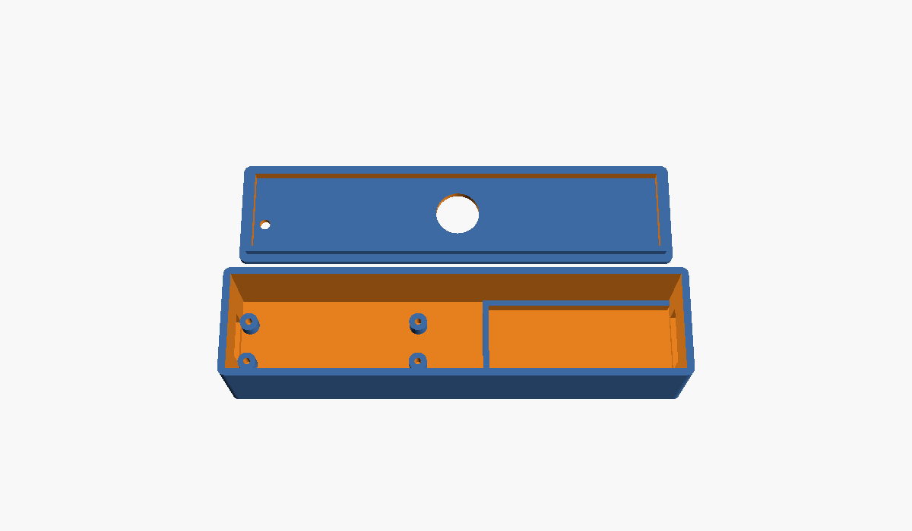

# Case

A two-part 3D-printed case for the Pico 2 (or Pico 2 W, same footprint) and the USB-A screw-terminal breakout, with a 12 mm push button in the lid.

- `harold_case.scad`: the parametric design (OpenSCAD). All sizes are variables at the top.
- `base.stl`, `lid.stl`: rendered with the default sizes.



## Before printing

The breakout defaults to 50 × 20 × 11.1 mm (Adafruit 3629). **Measure yours**, change `breakout_l`, `breakout_w` and `breakout_h` in the `.scad`, then re-export:

```sh
openscad -D 'part="base"' -o base.stl harold_case.scad
openscad -D 'part="lid"'  -o lid.stl  harold_case.scad
```

You can also edit it in the OpenSCAD app: open the file, use the Customizer panel, then press F6 and File → Export → STL.

## Printing

- Base: print open side up. Lid: print as exported (top face down, lip up). No supports needed.
- 0.2 mm layers and 20% infill are fine in PLA or PETG.
- If the lid is too tight or loose, change `clearance` (default 0.4 mm).

## Assembly

1. Screw the Pico onto the four standoffs, USB end against the left wall, with M2 × 4–6 mm self-tapping screws.
2. Press the breakout into its cradle at the right, socket through the wall opening.
3. Wire as in the main README, fit the button into the lid, wire it to GP15 and GND, then press the lid on.

## Outer size

About 124 × 30 × 27 mm with the defaults.
